# Xiaomi Dafang Hacks, with a new web interface

> [!NOTE]
> This repository is based on **[EliasKotlyar/Xiaomi-Dafang-Hacks](https://github.com/EliasKotlyar/Xiaomi-Dafang-Hacks)**,
> the custom firmware for Ingenic T10/T20 cameras (Xiaomi Dafang, Xiaofang 1S, Wyzecam V2 / Pan…).
> All the credit for the firmware goes to its authors and contributors: see the original repository for the
> project's history, issues and discussions.
>
> It is published as a single commit that contains the original project plus the changes described below.
> The [original README](#original-readme) follows.

The main change is a **new web interface** for the camera, written in [Svelte 5](https://svelte.dev), which
replaces the previous one, together with fixes to the CGI backend it talks to. Everything else (firmware,
scripts, binaries, documentation) is unchanged.

## Screenshots

*Taken with the fake backend included for development (`pnpm dev:mock`): the "camera picture" is a placeholder.*

| Live view, with pan / tilt controls | Camera switches |
| --- | --- |
| 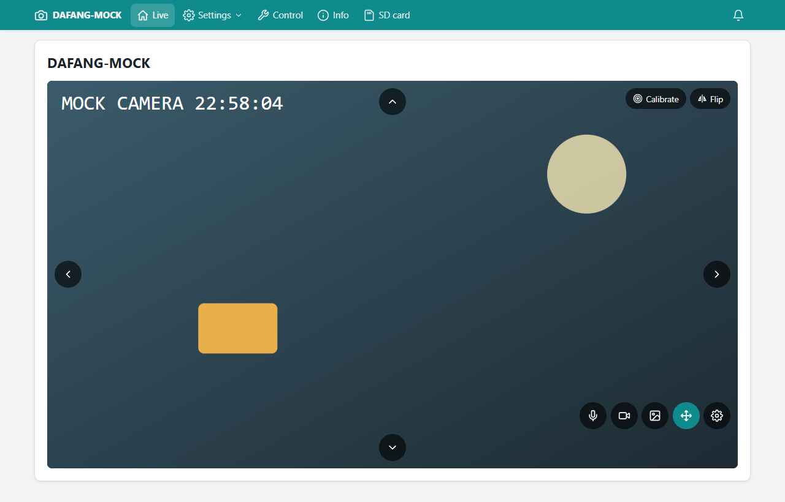 | 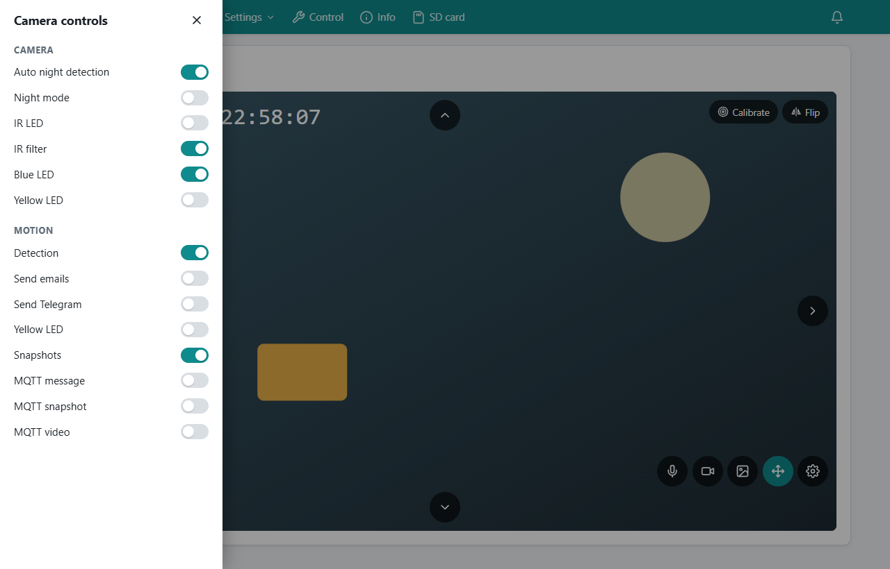 |
| **Camera settings** | **Motion detection zones** |
| 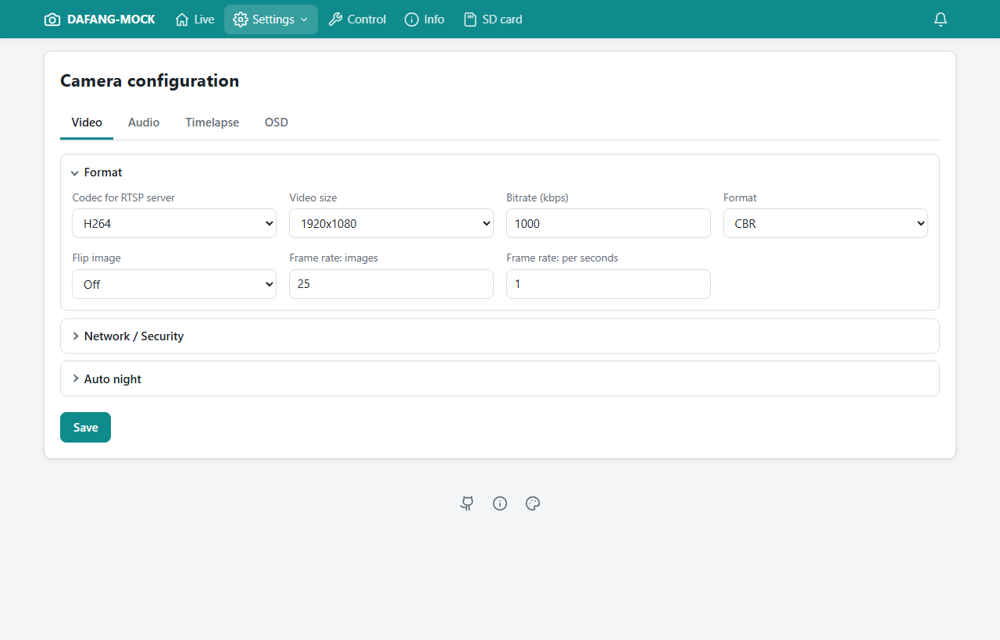 | 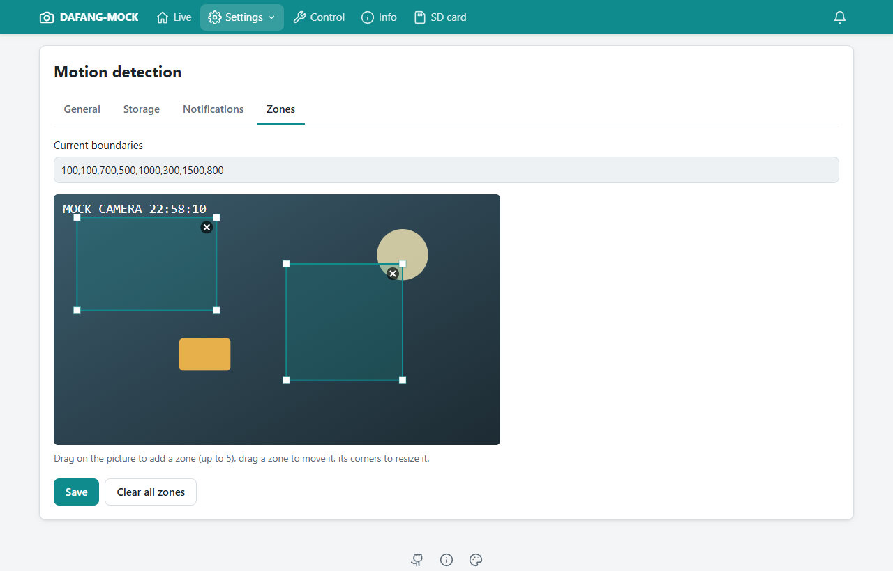 |
| **SD card files** | **Motion events timeline** |
| 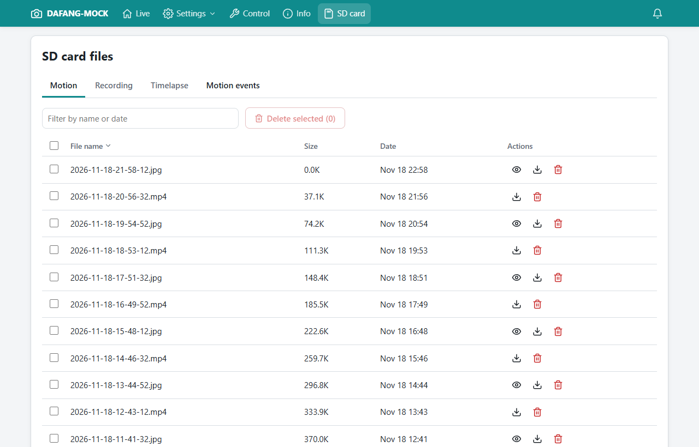 | 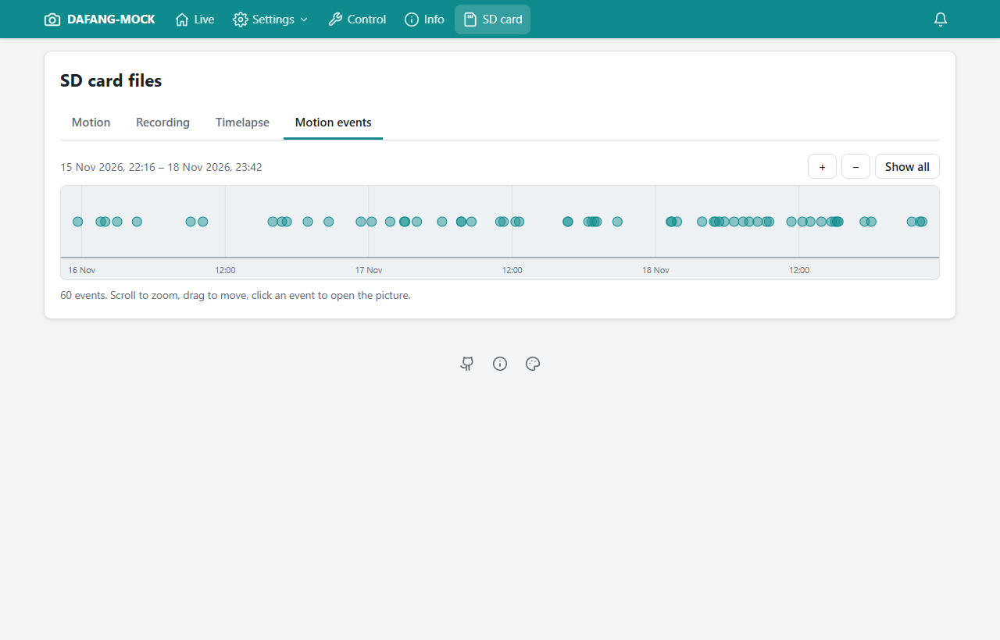 |
| **Configuration files editor** | **Dark theme: system information** |
| 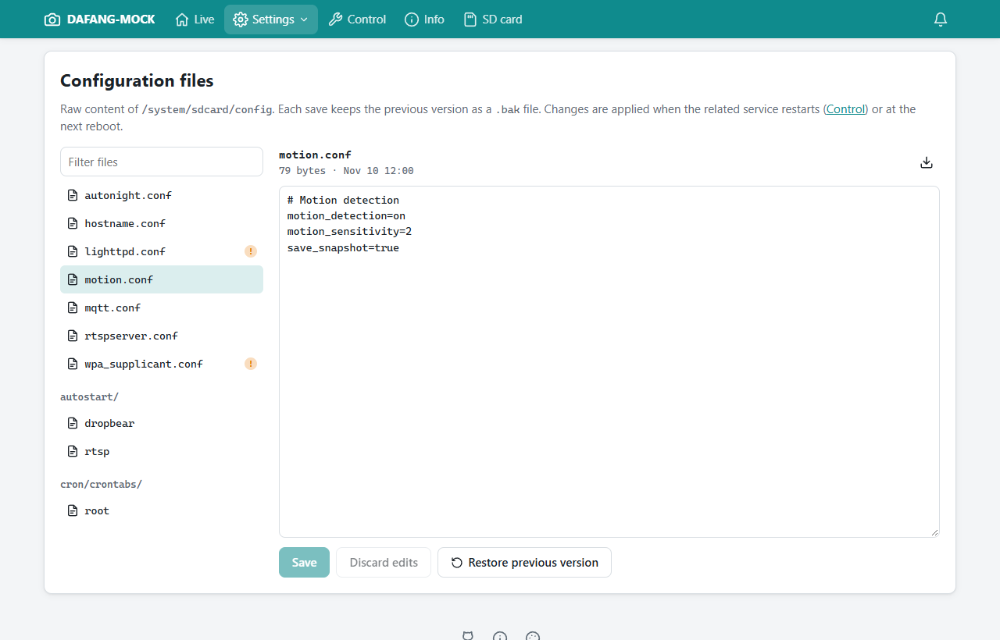 | 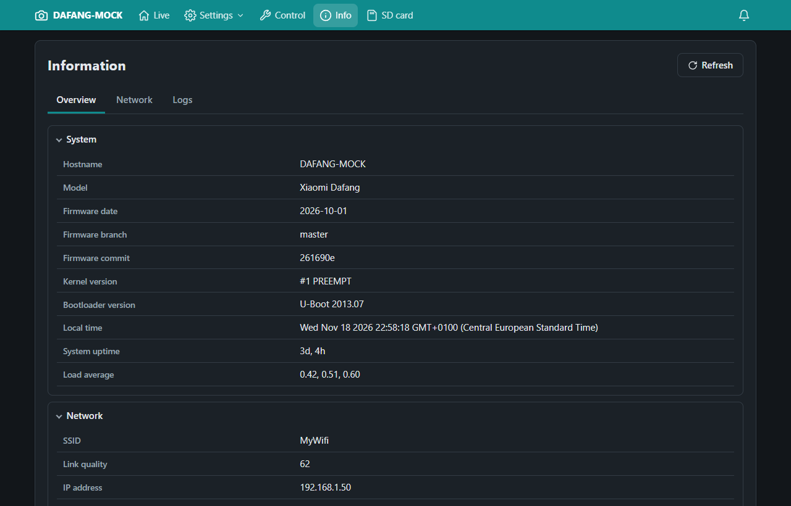 |
| **Dark theme: software night detection tuning** | |
| 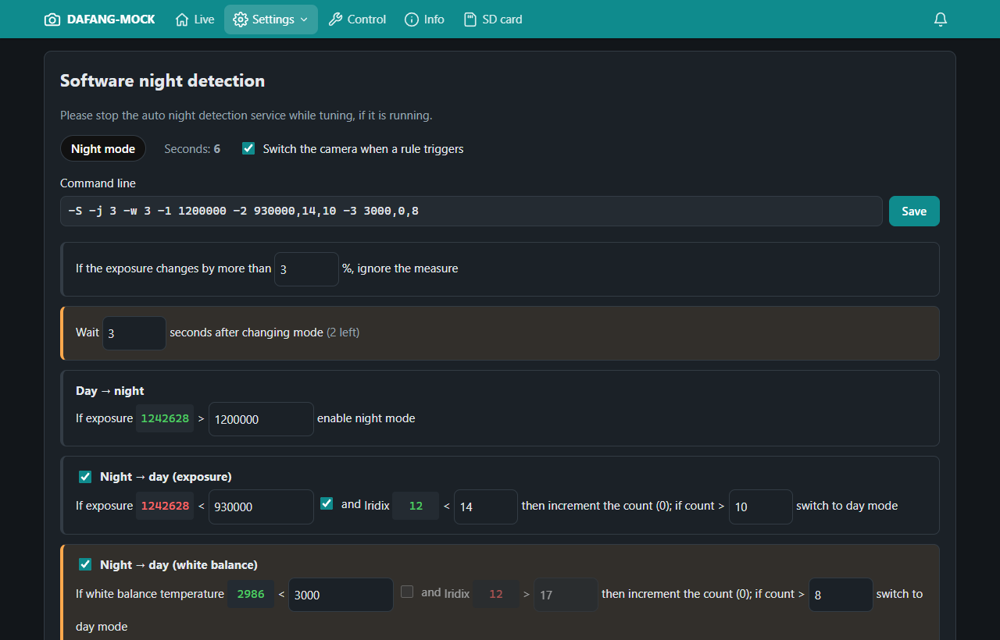 | |

On a phone:

  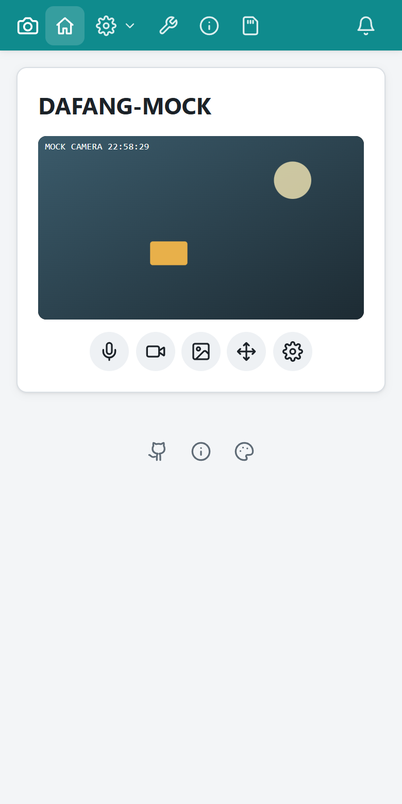
  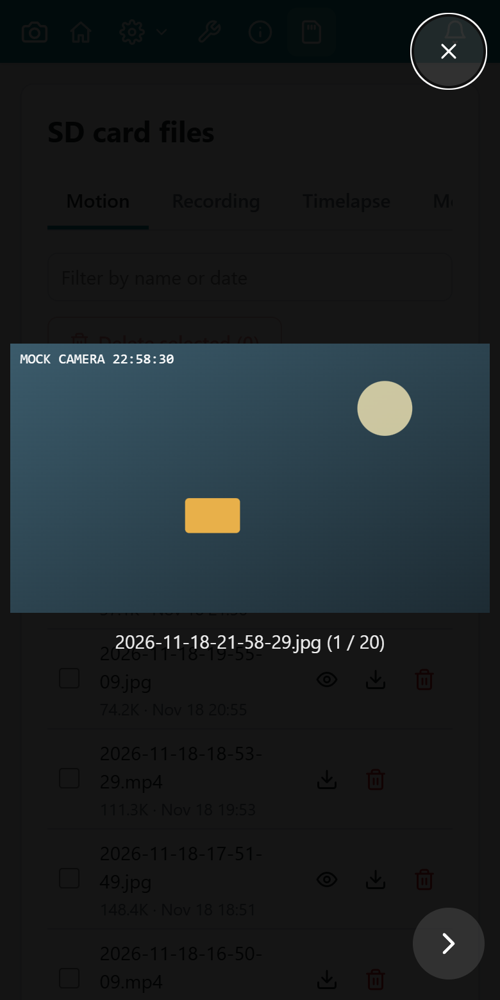
  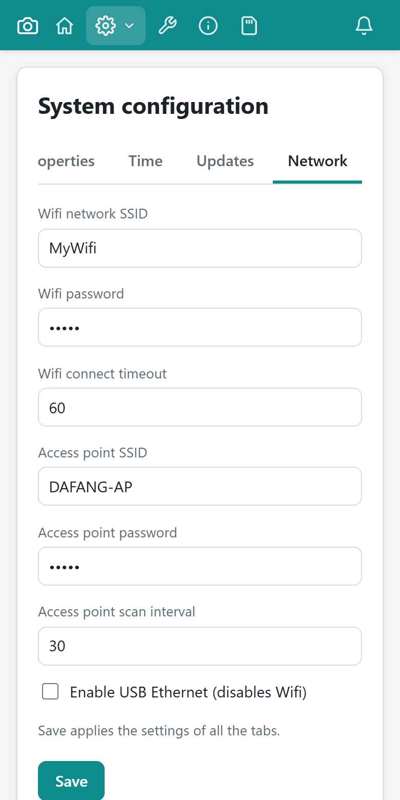

## Changes from the original project

### New web interface ([`web/`](web/))

A rewrite of the interface with Svelte 5 (runes), Vite and TypeScript. The sources are in `web/`, and the build
(`index.html` and two files in `assets/`) is committed in `firmware_mod/www/`, where it replaces the previous
jQuery / W3.CSS interface: installing the firmware installs it. It has every page of the previous interface: live
view, system, camera, network services, motion detection, software night detection, system control, information
and SD card.

- **Much lighter**: jQuery, DataTables, FontAwesome, d3, event-drops, smoothie and selectareas are replaced by small
  components. The build is about 145 KB of JavaScript (50 KB gzipped), instead of several MB of libraries.
- **Easier on the camera**: each tab and log section loads only when opened, polling waits for the previous request
  and stops while the browser tab is hidden, and the live picture is refreshed one image at a time.
- **Safer**: answers of the camera are always displayed as text, never as HTML. Reboot, shutdown, firmware update,
  restore and deletions ask for a confirmation.
- **Rebuilt tools**: a motion zone editor (draw, move, resize), a sortable and filterable file table with
  multi-selection, a picture viewer with previous / next, keyboard arrows and swipe, a zoomable timeline of the
  motion events, live charts for the software night detection, and push-to-talk recording without an external
  library.
- **New: configuration files editor**. *Settings → Configuration files* shows and edits the raw files of
  `/system/sdcard/config` (each save keeps a `.bak` copy, sensitive files ask for a confirmation).
- **Light / dark theme** with an accent color, and a layout that works on phones and tablets.
- **Development without a camera**: `pnpm dev:mock` serves the interface with a fake backend, and `pnpm dev`
  proxies to a real camera.

### CGI backend ([`firmware_mod/www/cgi-bin`](firmware_mod/www/cgi-bin))

- New `ui_config.cgi` for the configuration files editor: access limited to existing files of the configuration
  folder, private keys never sent, request body written as is (never decoded nor evaluated), backup before each
  save, atomic replacement.
- `func.cgi` no longer passes request data to `eval` (command injection), and parses parameters with shell
  builtins: no process fork for GET requests.
- Fewer processes per request (`read` instead of `grep | cut`, `head -c` instead of `dd bs=1`), which matters on the
  camera's single-core SoC, where the live page polls the status every 2 seconds.
- Fixed status reports: `state.cgi?cmd=all` always reported the motion options as off, and `ui_live.cgi` reported
  the snapshot option under the wrong name.
- The Information page no longer queries the GitHub API on each load (it took about 3 seconds).
- Plain text answers are served as `text/plain`.
- SD card: several files are deleted with a single request, and all the pictures are listed.

### Repository

- `.gitattributes` forces LF line endings: scripts checked out on Windows with CRLF fail on the camera.

## Installation

The interface is part of the firmware: follow the [original installation instructions](/hacks/install_cfw.md),
which copy `firmware_mod` to the SD card.

On a camera already running the custom firmware, update the web root of the SD card from `firmware_mod/www/`:

1. Back up `/system/sdcard/www`, for example `cp -a /system/sdcard/www /system/sdcard/www.old` over SSH.
2. Remove the files of the previous interface from `/system/sdcard/www`: the `*.html` files and the `js`, `css`,
   `lib` and `img` folders.
3. Copy `index.html`, `assets/` and `cgi-bin/` from `firmware_mod/www/` to `/system/sdcard/www/`
   (`cgi-bin` contains the updated backend and the new `ui_config.cgi`).

To modify the interface, edit `web/src` and run `pnpm build` in `web/`: it rebuilds `firmware_mod/www/index.html`
and `firmware_mod/www/assets/`, to commit with the sources. See [`web/README.md`](web/README.md) for development.

> [!WARNING]
> The camera's built-in updater (*Control → Update*) downloads from the original repository: running it brings
> back the previous interface files and replaces the modified backend files.

---

# Original README

## Xiaomi DaFang Hacks / XiaoFang 1S / Wyzecam V2 / Wyzecam Pan / Other T20 Devices

This repository contains custom firmware for the following devices:

Name | Picture
--- | ---
Xiaomi Dafang | 
Xiaomi Xiaofang 1S (old Version with T20 is supported, newer Version with T20L is in beta) | 
Wyzecam Pan | 
Wyzecam V2 | 
Neos SmartCam | 
Sannce I21AG, MixSight HX-I2110T2, WanScam HW0036, Digoo BB-M2 | 
Any other Device with Ingenic T10/T20 Device https://github.com/EliasKotlyar/Xiaomi-Dafang-Hacks/issues/980 | 

If you want to test the Xiaofang T20L (newer version) please check out the [additional instructions](https://github.com/EliasKotlyar/Xiaomi-Dafang-Hacks/blob/master/hacks/install_cfw_t20l.md).

If you have a classic XiaoFang with a ARM-Processor, consider using https://github.com/samtap/fang-hacks

### Attention: Do not install the latest Firmware on your Device. It will disable the support of this hack. 

Further information about this topic can be found here: https://github.com/EliasKotlyar/Xiaomi-Dafang-Hacks/issues/669

## How to install the CFW

Before you try to install it, please read the [FAQ](/hacks/faq.md)

After that, continue to the
[Installation](/hacks/install_cfw.md)

### Support

If you encounter a problem, please see first if you find similiar open/closed issues. 
Or ask in our [Gitter channel](https://gitter.im/Xiaomi-Dafang-Hacks/Lobby) for help.

If you don't find anything related, feel free to open a new issue.
If you/we solve your issue, please condense your gained insights into a pull request for continuous self-improvement.

### Partner Community:

We are really excited to announce that we have now a open source partner community, which provides a lot of content about the T10/T20/T30 Devices

Start here for more informations:
http://bbs.ebaina.com/thread-53811-1-1.html

欢迎来到这个存储库亲爱的朋友们。 从这里开始，获取关于在您的设备上获取此hack的教程：[开始](/hacks/install_cfw_cn.md)

## Technical Information about the hack:

Start [here](/hacks/technical.md)

## Integration in Home Automation Systems:

[Domoticz](/integration/domoticz/domoticz.md)

[Home Assistant](/integration/homeassistant/homeassistant.md)

[HomeKit](/integration/homekit/homekit.md)

[OpenHab](https://community.openhab.org/t/how-to-configure-a-hacked-xiaomi-dafang-to-work-with-openhab/51121)

[Synology](/integration/synology/synology.md)

[tinyCam](/integration/tinycam/tinycam.md)

[Zoneminder](/integration/zoneminder/zoneminder.md)

## Other features

### Motion detection

It is possible to run your own scripts on motion detection. See [here](/integration/custom/motiondetection.md)

## Contributions:

Any contribution to the development is highly welcome. Simply open a pull request against our beta branch on GitHub.
